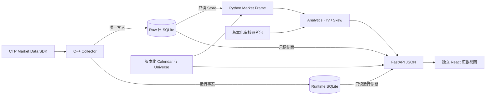

# 当前系统架构

本文回答“系统现在是什么结构”：组件职责、数据流、依赖方向、数据所有权和模块边界。选择这些边界的原因见[长期设计原则](DESIGN.md)，产品边界见 [MVP](docs/mvp.md)，精确行为与失败语义只由对应 [Contracts](docs/README.md) 定义。本文不记录实现完成度；当前代码与验证缺口见[验收矩阵](docs/acceptance.md)。

## 组件职责

| 组件 | 当前职责 | 边界 |
|---|---|---|
| CTP Market Data SDK | 提供外部行情回调与连接生命周期 | 是 Collector 的上游外部依赖，不是下游应用接口 |
| `collector/` 的 C++ runtime | 接收行情、按 CTP event time 聚合自然时间对齐的 15 秒 Market Bar，并管理连接、订阅和运行诊断 | Raw 的唯一 writer；不计算业务指标，不依赖 Query 或 Dashboard runtime |
| Raw 日 SQLite | 保存不可变 15 秒聚合事实、bucket-close CTP 市场状态、运行来源与观察时间 | 由 Collector 拥有；所有下游只读，不为页面或算法建立第二套事实 |
| Runtime SQLite | 拥有 Collector Run 生命周期、当前进程/逐合约事实与整体 Runtime History | Collector 唯一写入；只读消费者解释，不保存派生 Health；存储协议及实现差距见 [Raw Boundary](docs/contracts/raw-boundary.md#collector-运行诊断协议)与 [Acceptance](docs/acceptance.md#collector-第一阶段可靠性缺口) |
| `collector/scripts/universe.py` | 通过 Data Provider 的纯 Calendar 模块选择来源日，生成和发布版本化合约清单参考 | 是工具依赖，不进入 C++ runtime；不写行情，清单不替代 CTP 行情事实 |
| `data_provider/market_calendar.py` | 提供版本化交易日历、产品时段和逻辑交易日解释 | 是 Query 进程内源码模块；不改写源 TradingDay，不控制采集启停 |
| `data_provider/` | 只读访问 Raw，将显式 Universe/Calendar 组合为 Market Frame，并解释 data availability/coverage | Query 进程内源码模块；不写 Raw，不计算金融指标 |
| `analytics/` | 消费 Market Frame 与审核参考包，拥有数值核心、业务时间选择和 Market Indicator 计算 | Query 进程内源码模块；不直接读 Raw，不依赖 HTTP，不建立缓存或独立进程 |
| `query/` | 通过 Analytics 计算并发布可重建 Market Indicator JSON，同时发布 Data Provider 的只读诊断 | HTTP adapter 与 composition boundary；不解释 SQLite、Calendar 或 Market Frame 内部规则 |
| `dashboard/` | 构建独立 React 汇报页面；Docker 由 Nginx、原生 systemd 由 Vite 提供页面及 API 代理 | 只消费 JSON；不读 SQLite，不维护另一套指标公式 |
| `compose.yaml` / `scripts/deploy.sh` | 组成和管理仓库级三服务 Docker runtime | 属于系统 integration layer；服务内部构建和运行输入仍由各模块拥有 |
| 根 `tests/` 与模块测试 | 根测试组织跨模块回归并记录证据；模块测试证明 owner 行为 | 不定义产品行为，也不进入生产数据路径 |

## 数据流与依赖方向

1. Collector 从 SDK 接收 `DepthMarketData`，以 `ActionDay + UpdateTime + UpdateMillisec` 归入固定自然 15 秒 bucket，将已封口的 canonical Market Bar 写入按源 `TradingDay` 组织的 Raw 日库。
2. Data Provider 的只读 Store 从同一 Raw 目录取得事实；Market Frame 再结合显式 Universe 与 Calendar 形成稳定的下游读取模型。
3. Analytics 只消费 Market Frame 和独立审核参考包。业务 service 负责时间切片、读取身份固定及 JSON 投影。
4. FastAPI 提供 JSON；Dashboard 通过 API 展示业务结果和诊断，不跨过 API 访问数据文件。

Python 源码依赖固定为 `data_provider → analytics → query`：Data Provider 不依赖下游，Analytics 只可依赖 Data Provider，Query 可组合二者。唯一跨层工具例外是 `collector/scripts/universe.py` 直接复用 `data_provider.market_calendar`；C++ Collector runtime 不增加 Python 依赖。Dashboard、Analytics、Query 或参考数据故障不会形成反向调用来控制 Collector；部署工具协调生命周期，但不进入行情 callback 或 Raw 写入路径。

这里的 runtime 依赖不等于目录内所有工具的依赖：Universe 工具的上述 Calendar 例外不推广到其他 Collector 脚本；`collector/scripts/native.py` 虽位于 Collector 目录，却作为 repository integration 工具管理三个服务。两者均不改变采集 runtime 的故障隔离或 Raw 写所有权。

Collector Health 的解释边界位于 Query 进程内：Collector 发布 Runtime Facts，Data Provider 提供只读事实与 Calendar，Query 组合 Health evaluator 产生派生诊断。它不是新的服务或持久化事实库，不进入 Analytics 数值链路，也不反向控制 Collector；精确语义见 [Collector Health Contract](docs/contracts/collector-health.md)，接入程度见 [Acceptance](docs/acceptance.md#collector-health-缺口)。

Collector Run 生命周期的 authority 位于 Runtime DB；Raw 日库的 runs 仅保留本库 Market Bar provenance。Runtime History 与 Market facts 分开保存，通过 run identity 关联，不复制行情。两库独立提交，Runtime publication 失败不撤销已提交 Market facts；事务与失败规则由 [Raw Boundary](docs/contracts/raw-boundary.md#运行库与发布)拥有。外部 supervisor 属于部署层，负责进程退出及主循环失去进展后的恢复；CTP session 重连仍归 Collector。该职责不赋予 Query 或 Health evaluator 进程管理权，精确恢复要求见 [Deployment Contract](docs/contracts/deployment.md#runtime-自动恢复)。

## 数据所有权

| 数据/记录 | Owner | 允许的消费者 |
|---|---|---|
| Raw 行情日库与独立 Collector 运行状态 SQLite | Collector | Data Provider 只读访问；运维工具按契约检查或备份 |
| Universe generations 与源响应 | Universe 管理工具 | Collector 订阅入口、Market Frame、coverage 与审核流程 |
| Calendar 版本 | Data Provider | Market Frame、业务 service、coverage、Universe 工具与运维检查 |
| Analytics ReferenceBundle | 独立审核/导入流程 | Analytics 及其只读适配层 |
| IV / Skew 响应 | Analytics / business service | API 与 Dashboard；当前不是第二份持久化事实库 |
| 验收日志和现场证据 | Repository verification / 验收流程 | Acceptance 引用；不进入 runtime |

数据集的精确 schema、锁、版本、时间、质量、选择和错误规则不在本表重复，分别见 [Raw Boundary](docs/contracts/raw-boundary.md)、[Collector](collector/CONTRACT.md)、[Universe tool](collector/scripts/CONTRACT.md)、[Read Path](docs/contracts/read-path.md)、[Data Provider](data_provider/CONTRACT.md)、[Market Frame](data_provider/contracts/market-frame.md)、[Calendar / Universe](docs/contracts/market-session.md)、[Deployment](docs/contracts/deployment.md)及 [Analytics / Skew v1](analytics/contracts/analytics-skew.md)。

## Runtime 与模块边界

正式 runtime 由独立的 C++ Collector、Python Query/FastAPI 和 React Dashboard 组成。原生 systemd 通过 Vite 服务页面，Docker Compose 通过 Nginx 服务构建产物。两套部署入口共享上述组件边界，但具体进程、挂载、端口、构建输入和生命周期规则由 [Deployment Contract](docs/contracts/deployment.md)定义，实际命令见 [Operations](docs/operations.md)及模块 README。

native Collector unit 由部署侧 Python 标准库包装器启动 C++ 子进程，包装器只读主循环 Runtime heartbeat 并终止失效进程，由 systemd 创建下一 Process。该监控属于部署层，不向 C++ 采集链路引入 Python 或 Query 依赖；身份、信号和恢复参数由 [Native 自动恢复契约](docs/contracts/deployment.md#native-heartbeat-recovery)拥有。

本地 developer runner 的职责属于开发工具层，只组合现有组件进程，不进入业务数据流，也不成为持久部署管理器。其会话所有权由 [Developer Runner Contract](docs/contracts/developer-runner.md#repository-developer-runner-contract)规定；实现状态见 [Acceptance](docs/acceptance.md)。这一边界不新增业务组件或改变上文数据所有权。

`experiments/` 是探索空间，不是正式 runtime、Architecture 或 Contract 的替代来源。实验成果只有在明确纳入相应正式模块并同步 Architecture/Contract 后，才成为系统结构的一部分。
