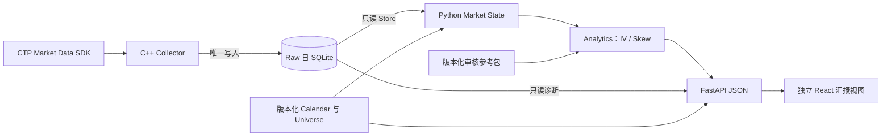
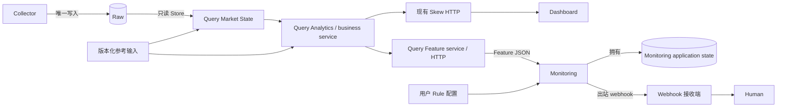

# 当前系统架构

本文回答“系统现在是什么结构”：组件职责、数据流、依赖方向、数据所有权和模块边界。选择这些边界的原因见[长期设计原则](DESIGN.md)，产品边界见 [MVP](docs/mvp.md)，精确行为与失败语义只由对应 [Contracts](docs/README.md) 定义。本文不记录实现完成度；当前代码与验证缺口见[验收矩阵](docs/acceptance.md)。

## 组件职责

| 组件 | 当前职责 | 边界 |
|---|---|---|
| CTP Market Data SDK | 提供外部行情回调与连接生命周期 | 是 Collector 的上游外部依赖，不是下游应用接口 |
| `collector/` 的 C++ runtime | 接收行情、维护最新内存状态并物化 Raw；管理采集侧连接、订阅和运行诊断 | Raw 的唯一 writer；不计算业务指标，不依赖 Query 或 Dashboard runtime |
| Raw 日 SQLite | 保存 Collector 实际物化的行情事实、运行身份与时间来源 | 由 Collector 拥有；所有下游只读，不为页面或算法建立第二套事实 |
| `collector/scripts/universe.py` | 通过 Query 的纯 Calendar 模块选择来源日，生成和发布版本化合约清单参考 | 是工具依赖，不进入 C++ runtime；不写行情，清单不替代 CTP 行情事实 |
| `query/market_calendar.py` | 提供版本化交易日历、产品时段和逻辑交易日解释 | 不改写源 TradingDay，不控制采集启停 |
| `query/` | 只读访问 Raw，将显式 Universe/Calendar 组合为 Market State，并计算和发布可重建 Analytics / Feature JSON | 不写 Raw、不依赖 Dashboard/Monitoring；内部关系见 [Query Architecture](query/ARCHITECTURE.md) |
| `dashboard/` | 构建独立 React 汇报页面；Docker 由 Nginx、原生 systemd 由 Vite 提供页面及 API 代理 | 只消费 JSON；不读 SQLite，不维护另一套指标公式 |
| `compose.yaml` / `scripts/deploy.sh` | 组成和管理仓库级三服务 Docker runtime | 属于系统 integration layer；服务内部构建和运行输入仍由各模块拥有 |
| `harness/` 与模块测试 | 组织回归并记录验证证据 | 不定义产品行为，也不进入生产数据路径 |

## 数据流与依赖方向

1. Collector 从 SDK 接收行情并把实际物化结果写入按源交易日组织的 Raw 日库。
2. Query 的只读 Store 从同一 Raw 目录取得事实；Market State 再结合显式 Universe 与 Calendar 形成稳定的下游读取模型。
3. Analytics 只消费 Market State frame 和独立审核参考包。业务 service 负责时间切片、读取身份固定及 JSON 投影。
4. FastAPI 提供 JSON；Dashboard 通过 API 展示业务结果和诊断，不跨过 API 访问数据文件。

正式依赖只沿图中箭头向下游移动。Dashboard、Analytics、Query 或参考数据故障不会形成反向调用来控制 Collector；部署工具协调生命周期，但不进入行情 callback 或 Raw 写入路径。

这里的 runtime 依赖不等于目录内所有工具的依赖：`collector/scripts/universe.py` 实际导入 `query/market_calendar.py`，但 C++ Collector 不导入或启动 Query；`collector/scripts/native.py` 虽位于 Collector 目录，却作为 repository integration 工具管理三个服务。两者均不改变采集 runtime 的故障隔离或 Raw 写所有权。

## 数据所有权

| 数据/记录 | Owner | 允许的消费者 |
|---|---|---|
| Raw 行情日库与采集运行诊断 | Collector | Query 只读访问；运维工具按契约检查或备份 |
| Universe generations 与源响应 | Universe 管理工具 | Collector 订阅入口、Market State、coverage 与审核流程 |
| Calendar 版本 | Query 参考数据模块 | Market State、业务 service、coverage 与运维检查 |
| Analytics ReferenceBundle | 独立审核/导入流程 | Analytics 及其只读适配层 |
| IV / Skew 响应 | Analytics / business service | API 与 Dashboard；当前不是第二份持久化事实库 |
| 验收日志和现场证据 | Harness / 验收流程 | Acceptance 引用；不进入 runtime |

数据集的精确 schema、锁、版本、时间、质量、选择和错误规则不在本表重复，分别见 [Raw Boundary](docs/contracts/raw-boundary.md)、[Collector](collector/CONTRACT.md)、[Universe tool](collector/scripts/CONTRACT.md)、[Read Path](docs/contracts/read-path.md)、[Query](query/CONTRACT.md)、[Market State](query/contracts/market-state.md)、[Calendar / Universe](docs/contracts/market-session.md)、[Deployment](docs/contracts/deployment.md)及 [Analytics / Skew v1](query/contracts/analytics-skew.md)。

## Runtime 与模块边界

正式 runtime 由独立的 C++ Collector、Python Query/FastAPI 和 React Dashboard 组成。原生 systemd 通过 Vite 服务页面，Docker Compose 通过 Nginx 服务构建产物。两套部署入口共享上述组件边界，但具体进程、挂载、端口、构建输入和生命周期规则由 [Deployment Contract](docs/contracts/deployment.md)定义，实际命令见 [Operations](docs/operations.md)及模块 README。

本地 developer runner 的职责属于开发工具层，只组合现有组件进程，不进入业务数据流，也不成为持久部署管理器。其会话所有权由 [Developer Runner Contract](docs/contracts/developer-runner.md#repository-developer-runner-contract)规定；实现状态见 [Acceptance](docs/acceptance.md)。这一边界不新增业务组件或改变上文数据所有权。

`experiments/` 是探索空间，不是正式 runtime、Architecture 或 Contract 的替代来源。实验成果只有在明确纳入相应正式模块并同步 Architecture/Contract 后，才成为系统结构的一部分。

## Monitoring v1 目标结构（已冻结，待实现）

本节是 [MVP 平行扩展](docs/mvp.md)的目标边界，不将现有三组件部署改称已部署四组件。Monitoring 当前实现/验证程度见 [Monitoring Acceptance](monitoring/ACCEPTANCE.md)。

图中箭头表示跨模块数据流；运行调用为 Monitoring → Query HTTP，以及 Monitoring → 用户配置的 webhook 接收端。不存在 Collector → Analytics/Monitoring、Query → Monitoring 或 Dashboard 本地规则判断的代码依赖；Monitoring 内部判断、提交和投递关系只见[本级 Architecture](monitoring/ARCHITECTURE.md)。

### 必须落地的边界与保留的实现

- Market State、Feature、Conclusion、Opportunity Event 的语义分别由 [Market State](query/contracts/market-state.md)、[Feature](docs/contracts/features.md)和 [Monitoring](monitoring/CONTRACT.md) Contracts 定义；目录归属不混淆语义归属。
- Market State、Analytics 数值核心、参考包适配和 SkewService 位于 `query/`。现有 Feature service 和 HTTP 投影复用它们；现有 API 与 Dashboard 保持兼容。
- `monitoring/` 目标为一个可选独立前台进程，经 Feature HTTP 消费输入并拥有专属 application state；内部职责关系见 [Monitoring Architecture](monitoring/ARCHITECTURE.md)。
- Monitoring 只经 Feature HTTP 消费指标；访问禁令、挂载隔离、失败隔离与组件生命周期约束唯一见 [Deployment Contract](docs/contracts/deployment.md#monitoring-v1-跨系统边界已冻结待实现)。
- Analytics/provider 不依赖 Monitoring，Query 不依赖 Monitoring 启动，也不为显示指标读取规则状态。规则判断与投递的内部分工见 [Monitoring Architecture](monitoring/ARCHITECTURE.md)。
- 首版不提取顶层 `analytics/`，不新增消息队列、Derived Market DB 或 distributed runtime。共享包提取以独立 Python 消费者、独立发布需求或 HTTP 性能证据为触发条件，理由见 [Design](DESIGN.md)；提取不得改变 Feature 业务语义。

### 扩展数据所有权

| 数据/状态 | Owner | 持久化与消费者 |
|---|---|---|
| Raw / Market State / ReferenceBundle | 沿用上文 Collector 与 Query 所有权 | Monitoring 无直接行情访问权；参考输入仍由独立审核流程维护 |
| Feature 结果 | Query Analytics / provider | 按请求计算、可重建；Query API、Dashboard API 消费者和 Monitoring 可消费 |
| rolling market window | Feature provider | 后续指标按需从 Market State 重建；可丢弃缓存，不归 Rule Engine，不成为新 Market Facts |
| Rule configuration | 用户定义；Monitoring 负责校验 | 本地配置；已应用版本保存至 application state |
| Monitoring application facts | Monitoring | 专属 application state，包含 Evaluation State、Opportunity Event 与 delivery evidence；不取代原行情与参考 authority |

application store 是专属应用持久目录，不位于 Collector 数据目录。原子提交、去重、缺口、配置版本和投递恢复的唯一行为来源为 [Monitoring Contract](monitoring/CONTRACT.md)，不得用物理共库推导通知可以修改事件或规则状态。

目标 runtime 仅增加一个可选本地进程，不接入当前 Compose/systemd 或平行 developer runner；生命周期约束见 [Deployment Contract](docs/contracts/deployment.md)。故障隔离是调用、进程和写所有权边界，不承诺同宿主 CPU/磁盘资源完全隔离；轮询负载与延迟需实际验证，不能以进程独立替代性能证据。
