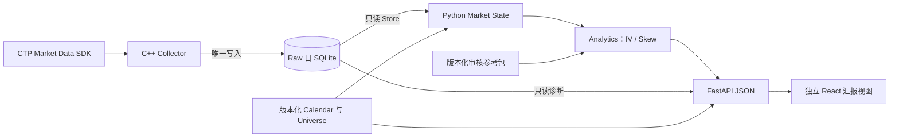
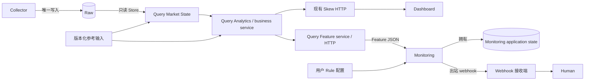

<a id="repository-system-architecture"></a>

# 当前系统架构

本文回答“系统现在是什么结构”：组件职责、数据流、依赖方向、数据所有权和模块边界。选择这些边界的原因见[长期设计原则](DESIGN.md)，产品边界见 [MVP](docs/mvp.md)，精确行为与失败语义只由对应 [Contracts](docs/README.md) 定义。本文不记录实现完成度；当前代码与验证缺口见[验收矩阵](docs/acceptance.md)。



## 组件职责

| 组件 | 当前职责 | 边界 |
|---|---|---|
| CTP Market Data SDK | 提供外部行情回调与连接生命周期 | 是 Collector 的上游外部依赖，不是下游应用接口 |
| `collector/` 的 C++ runtime | 接收行情、维护最新内存状态并物化 Raw；管理采集侧连接、订阅和运行诊断 | Raw 的唯一 writer；不计算业务指标，不依赖 Query 或 Dashboard runtime |
| Raw 日 SQLite | 保存 Collector 实际物化的行情事实、运行身份与时间来源 | 由 Collector 拥有；所有下游只读，不为页面或算法建立第二套事实 |
| `collector/scripts/universe.py` | 通过 Query 的纯 Calendar 模块选择来源日，生成和发布版本化合约清单参考 | 是工具依赖，不进入 C++ runtime；不写行情，清单不替代 CTP 行情事实 |
| `query/market_calendar.py` | 提供版本化交易日历、产品时段和逻辑交易日解释 | 不改写源 TradingDay，不控制采集启停 |
| `query/` | 只读访问 Raw，将显式 Universe/Calendar 组合为 Market State，并计算和发布可重建 Analytics / Feature JSON | 不写 Raw、不依赖 Dashboard/Monitoring；内部关系见 [Query Architecture](query/ARCHITECTURE.md) |
| `dashboard/` | 构建独立 React 汇报页面；Docker 由 Nginx、原生 systemd 由 Vite 提供页面及 API 代理 | 只消费 JSON；不读 SQLite，不维护另一套指标公式 |
| `compose.yaml` / `scripts/deploy.sh` | 组成和管理仓库级三服务 Docker runtime | 属于系统 integration layer；服务内部构建和运行输入仍由各模块拥有 |
| `harness/` 与模块测试 | 组织回归并记录验证证据 | 不定义产品行为，也不进入生产数据路径 |

## 数据流与依赖方向

1. Collector 从 SDK 接收行情并把实际物化结果写入按源交易日组织的 Raw 日库。
2. Query 的只读 Store 从同一 Raw 目录取得事实；Market State 再结合显式 Universe 与 Calendar 形成稳定的下游读取模型。
3. Analytics 只消费 Market State frame 和独立审核参考包。业务 service 负责时间切片、读取身份固定及 JSON 投影。
4. FastAPI 提供 JSON；Dashboard 通过 API 展示业务结果和诊断，不跨过 API 访问数据文件。

正式依赖只沿图中箭头向下游移动。Dashboard、Analytics、Query 或参考数据故障不会形成反向调用来控制 Collector；部署工具协调生命周期，但不进入行情 callback 或 Raw 写入路径。

这里的 runtime 依赖不等于目录内所有工具的依赖：`collector/scripts/universe.py` 实际导入 `query/market_calendar.py`，但 C++ Collector 不导入或启动 Query；`collector/scripts/native.py` 虽位于 Collector 目录，却作为 repository integration 工具管理三个服务。两者均不改变采集 runtime 的故障隔离或 Raw 写所有权，精确允许边登记在 [authority registration](.authority.json)。

## 数据所有权

| 数据/记录 | Owner | 允许的消费者 |
|---|---|---|
| Raw 行情日库与采集运行诊断 | Collector | Query 只读访问；运维工具按契约检查或备份 |
| Universe generations 与源响应 | Universe 管理工具 | Collector 订阅入口、Market State、coverage 与审核流程 |
| Calendar 版本 | Query 参考数据模块 | Market State、业务 service、coverage 与运维检查 |
| Analytics ReferenceBundle | 独立审核/导入流程 | Analytics 及其只读适配层 |
| IV / Skew 响应 | Analytics / business service | API 与 Dashboard；当前不是第二份持久化事实库 |
| 验收日志和现场证据 | Harness / 验收流程 | Acceptance 引用；不进入 runtime |

数据集的精确 schema、锁、版本、时间、质量、选择和错误规则不在本表重复，分别见 [Raw Boundary](docs/contracts/raw-boundary.md)、[Collector](collector/CONTRACT.md)、[Universe tool](collector/scripts/CONTRACT.md)、[Read Path](docs/contracts/read-path.md)、[Query](query/CONTRACT.md)、[Market State](query/contracts/market-state.md)、[Calendar / Universe](docs/contracts/market-session.md)、[Deployment](docs/contracts/deployment.md)及 [Analytics / Skew v1](query/contracts/analytics-skew.md)。

## Runtime 与模块边界

正式 runtime 由独立的 C++ Collector、Python Query/FastAPI 和 React Dashboard 组成。原生 systemd 通过 Vite 服务页面，Docker Compose 通过 Nginx 服务构建产物。两套部署入口共享上述组件边界，但具体进程、挂载、端口、构建输入和生命周期规则由 [Deployment Contract](docs/contracts/deployment.md)定义，实际命令见 [Operations](docs/operations.md)及模块 README。

本地 developer runner 的职责属于开发工具层，只组合现有组件进程，不进入业务数据流，也不成为持久部署管理器。其会话所有权由 [Deployment Contract](docs/contracts/deployment.md#developer-runner-的生命周期边界)规定；实现状态见 [Acceptance](docs/acceptance.md)。这一边界不新增业务组件或改变上文数据所有权。

`experiments/` 是探索空间，不是正式 runtime、Architecture 或 Contract 的替代来源。实验成果只有在明确纳入相应正式模块并同步 Architecture/Contract 后，才成为系统结构的一部分。

## Monitoring v1 目标结构（已冻结，待实现）

本节是 [MVP 平行扩展](docs/mvp.md)的目标边界，不将现有三组件部署改称已部署四组件。Monitoring 当前实现/验证程度见 [Monitoring Acceptance](monitoring/ACCEPTANCE.md)；结构变化以 additive development 落地。



图中箭头表示跨模块数据流；运行调用为 Monitoring → Query HTTP，以及 Monitoring → 用户配置的 webhook 接收端。不存在 Collector → Analytics/Monitoring、Query → Monitoring 或 Dashboard 本地规则判断的代码依赖；Monitoring 内部判断、提交和投递关系只见[本级 Architecture](monitoring/ARCHITECTURE.md)。

### 必须落地的边界与保留的实现

- Market State、Feature、Conclusion、Opportunity Event 的语义分别由 [Market State](query/contracts/market-state.md)、[Feature](docs/contracts/features.md)和 [Monitoring](monitoring/CONTRACT.md) Contracts 定义；目录归属不混淆语义归属。
- Market State、Analytics 数值核心、参考包适配和 SkewService 暂留 `query/`。新增薄 Feature service 和 HTTP 投影复用它们；现有 API 与 Dashboard 保持兼容，不迁移首页。
- `monitoring/` 目标为一个可选独立前台进程，经 Feature HTTP 消费输入并拥有专属 application state；内部职责关系见 [Monitoring Architecture](monitoring/ARCHITECTURE.md)。
- Monitoring 只经 Feature HTTP 消费指标，不读 Raw、不导入 Query 内部模块、不挂载行情目录。Query 不依赖 Monitoring 启动，也不为显示指标读取规则状态。
- Analytics/provider 不依赖 Monitoring；任何 Monitoring 或通知错误都不能成为 Query/Collector 停启、写入或健康的前置条件。规则判断与投递的内部分工见 [Monitoring Architecture](monitoring/ARCHITECTURE.md)。
- 首版不提取顶层 `analytics/`，不新增消息队列、Derived Market DB 或 distributed runtime。共享包提取以独立 Python 消费者、独立发布需求或 HTTP 性能证据为触发条件，理由见 [Design](DESIGN.md)；提取不得改变 Feature 业务语义。

### 扩展数据所有权

| 数据/状态 | Owner | 持久化与消费者 |
|---|---|---|
| Raw / Market State / ReferenceBundle | 沿用上文 Collector 与 Query 所有权 | Monitoring 无直接行情访问权；参考输入仍由独立审核流程维护 |
| Feature 结果 | Query Analytics / provider | 按请求计算、可重建；Query API、Dashboard API 消费者和 Monitoring 可消费 |
| rolling market window | Feature provider | 后续指标按需从 Market State 重建；可丢弃缓存，不归 Rule Engine，不成为新 Market Facts |
| Rule configuration | 用户定义；Monitoring 负责校验 | 本地配置；已应用版本保存至 application state |
| Monitoring application facts | Monitoring | 专属 application state，包含 Evaluation State、Opportunity Event 与 delivery evidence；不取代原行情与参考 authority |

application store 是专属应用持久目录，不位于 Collector 数据目录。原子提交、去重、缺口、配置版本和投递恢复的唯一行为来源为 [Monitoring Contract](monitoring/CONTRACT.md)，不得用物理共库推导通知可以修改事件或规则状态。

目标 runtime 仅增加一个可选本地进程，不接入当前 Compose/systemd 或平行 developer runner；生命周期约束见 [Deployment Contract](docs/contracts/deployment.md)。故障隔离是调用、进程和写所有权边界，不承诺同宿主 CPU/磁盘资源完全隔离；轮询负载与延迟需实际验证，不能以进程独立替代性能证据。

<a id="knowledge-topology"></a>

## Repository knowledge architecture：冻结目标

本节拥有 documentation topology 和语义归属 mapping；治理规则唯一见[文档入口](docs/README.md#authority-rules)。目标布局保持冻结，表格逐项反映当前归属及尚未执行的目标。根、Collector/Collector tools、Query、Dashboard、Monitoring 及 Harness authority 已归位。实施状态见 [Acceptance](docs/acceptance.md#semantic-authority-s7)，最终治理顺序见 [ExecPlan](docs/semantic-embedding-execplan.md)。

当前导航为根 AGENTS/README/DESIGN/ARCHITECTURE → docs 入口与共享 Contracts；Collector、tools、Query、Dashboard、Monitoring 与 Harness 已有局部入口和对应 authority。Harness README 负责实际用法，Contract 负责验证/证据语义，AGENTS 负责局部工作纪律。实验区仍沿用逐层 SPEC/REFERENCE 组织，并只从上层链接其现有入口。

冻结目标文件如下；未列出的对称文件不创建。已完成迁移的旧中央副本不保留，尚未执行的目标不预先视为当前 authority。

```text
/
├─ AGENTS.md / README.md / DESIGN.md / ARCHITECTURE.md / .authority.json
├─ docs/
│  ├─ README.md / mvp.md / acceptance.md / operations.md
│  ├─ contracts/
│  │  ├─ raw-boundary.md / read-path.md / market-session.md
│  │  └─ features.md / deployment.md
│  ├─ references/
│  └─ archive/
├─ collector/
│  ├─ AGENTS.md / README.md / ARCHITECTURE.md / CONTRACT.md / .authority.json
│  └─ scripts/
│     └─ AGENTS.md / README.md / CONTRACT.md / .authority.json
├─ query/
│  ├─ AGENTS.md / README.md / DESIGN.md / ARCHITECTURE.md
│  ├─ CONTRACT.md / ACCEPTANCE.md / .authority.json
│  ├─ contracts/
│  │  ├─ market-state.md / analytics-skew.md / analytics-skew-v1.json
│  │  └─ references.md
│  ├─ references/analytics-skew-sources.md
│  └─ calendars/README.md / .authority.json
├─ dashboard/
│  └─ AGENTS.md / README.md / CONTRACT.md / ACCEPTANCE.md / .authority.json
├─ monitoring/
│  ├─ AGENTS.md / README.md / DESIGN.md / ARCHITECTURE.md
│  └─ CONTRACT.md / ACCEPTANCE.md / .authority.json
├─ harness/
│  ├─ AGENTS.md / README.md / CONTRACT.md / .authority.json
│  └─ 原有实现、测试、oracle、fixtures
└─ experiments/（原位保留）
```

`query/contracts/` 是扁平 Query 的文档分卷，不是代码子模块；Calendar 解释算法仍归 Query，`query/calendars/` 只拥有参考文件维护入口。`collector/scripts/` 是现有真实工具 scope。根 `scripts/` 当前承担 repository integration，由系统 Operations/Deployment 导航，不另加空文档。

Monitoring 已建立非空文档 scope，README 当前只导航设计和状态；没有实现时不提供虚构运行命令。不预建 rules/notification/storage 子目录，不创建顶层 analytics 包。

实验入口为 [CTP](experiments/ctp/README.md) 和 [Data Coverage](experiments/data_coverage/README.md)。后者已有 AGENTS/DESIGN/SPEC → 数据类型 SPEC → 来源 REFERENCE/coverage/templates，是 progressive disclosure 案例；本次不更改其内容、命名、样本或局部规则。

<a id="authority-mapping"></a>

## Current → target authority mapping

本表是归属与导航 authority，不复制业务规则。左列是迁移前可读取的真实来源，右列是冻结目标。尚未执行时以左列定义为准；每项迁移原子切换链接与定义，再将本表更新为现行归属导航，移除已无用途的旧来源说明。执行状态不在本表维护。

| 当前来源 / 语义范围 | 唯一目标及拆分边界 |
|---|---|
| [根 AGENTS](AGENTS.md)、[docs 入口](docs/README.md) | 根 AGENTS 工作纪律及导航；docs README 治理规则。根不列全仓领域必读清单 |
| [根 Design](DESIGN.md) §1–8、[Query Design](query/DESIGN.md) | 跨模块原则在根；Analytics 按请求计算等局部理由已归 Query |
| 根 Design §9、Query Design | HTTP 共享、拆包触发和反向依赖理由留根；薄 provider 组织理由已归 Query |
| [根 Design](DESIGN.md) §10、[Monitoring Design](monitoring/DESIGN.md) | 与 Market Facts 的跨模块边界留根；机会记录/通知恢复内部取舍已归 Monitoring |
| [本文](ARCHITECTURE.md)、[Query Architecture](query/ARCHITECTURE.md)、[Monitoring Architecture](monitoring/ARCHITECTURE.md) | 一级模块、跨模块流、当前/目标 runtime 在根；Query 文件关系与 Monitoring 循环/存储结构分别归本级 |
| [Collector Contract](collector/CONTRACT.md)、[Raw Boundary](docs/contracts/raw-boundary.md) | Raw 共享读写、锁、诊断协议归 raw-boundary；callback、采样、session、配置、重连、提交和 Collector 自身停止归本地 Contract |
| [Read Path](docs/contracts/read-path.md)、[Query Contract](query/CONTRACT.md)：边界/健康/SQLite | 公共 HTTP 留 read-path；Query 内部读取要求已归本级；系统 lifecycle 与共享 Raw/心跳各引用其协议 |
| Read Path：Skew | HTTP 参数、wire shape、状态映射保留根 read-path；分钟选择、series 计算引用 Query Skew，删除重复定义 |
| [Read Path](docs/contracts/read-path.md)、[Dashboard Contract](dashboard/CONTRACT.md) | 公共 HTTP 协议与 wire shape 留根；布局、轮询、失败清值、显示精度、历史与当前视图交互已归 Dashboard |
| [Market Session](docs/contracts/market-session.md)、[Universe Tool](collector/scripts/CONTRACT.md)、[Query Contract](query/CONTRACT.md)、[Dashboard Contract](dashboard/CONTRACT.md) | Calendar/Universe 跨模块版本、时间、交接协议留根；来源抓取/发布归工具；Query Calendar/coverage 适配归本级；页面时段表归 Dashboard |
| [Market State](query/contracts/market-state.md) | 已归 Query；引用根 Raw/Calendar 协议，不重复采集事实 |
| [Skew](query/contracts/analytics-skew.md)、[Reference adapter](query/contracts/references.md)、[Query Acceptance](query/ACCEPTANCE.md)、[Dashboard Contract](dashboard/CONTRACT.md) | 数值、solver、参考适配和 Query 证据归 Query；显示精度、状态标识与页面交互归 Dashboard |
| [Skew 策略](query/contracts/analytics-skew-v1.json)、[来源说明](query/references/analytics-skew-sources.md) | 已按字节/原文归 Query；共享原件档案不动 |
| [Feature](docs/contracts/features.md)、[Query Contract](query/CONTRACT.md) | 通用 envelope、身份/采样键、时间、错误、版本、消费者与窗口归属边界留根；registry/provider 内部要求已归 Query；Skew 映射留根并引用 Query 数值契约 |
| [Monitoring](monitoring/CONTRACT.md) | Rule、crossing、UNKNOWN、配置、事务、恢复和投递归 Monitoring；跨模块访问和系统 lifecycle 引用根 |
| [Deployment](docs/contracts/deployment.md) | 保留真实跨组件约束；Collector 自身停机引用 Collector；Monitoring 自有停止、锁与重试引用 Monitoring |
| [Collector README](collector/README.md)、[scripts README](collector/scripts/README.md) | Collector 配置/直接运行用法与工具命令已分开；已有规范归各自 Contract；三服务部署教程归根 Operations |
| [Query README](query/README.md)、[Dashboard README](dashboard/README.md) | 保留实际用法、故障定位并增加本级导航；Query 增加已实现 Feature 用法 |
| [Calendar README](query/calendars/README.md) | 保留参考数据维护步骤，不承接 Query 解释算法 |
| [Acceptance](docs/acceptance.md)、[Query Acceptance](query/ACCEPTANCE.md)、[Dashboard Acceptance](dashboard/ACCEPTANCE.md)、[Monitoring Acceptance](monitoring/ACCEPTANCE.md) | G1–G6/P1/P2、跨进程/部署/runner 证据留根；Query、Dashboard 与 Monitoring 局部记录已迁入各自 ACCEPTANCE，根只链接，不复制进度 |
| [Operations](docs/operations.md) | 系统组合、部署、备份恢复保留根；模块操作归所属 README，根导航而不重复步骤 |
| [Harness README](harness/README.md)、[Harness Contract](harness/CONTRACT.md)、[Harness AGENTS](harness/AGENTS.md) | README 保留用法/依赖；PASS/FAIL/NOT_RUN、证据身份和结果边界归 Contract，工作指导归 AGENTS |
| [Monitoring execution plan](docs/monitoring-execution-plan.md) | 仍为独立一次性交接；只更新链接与恢复说明，不成为规则定义，不因文档迁移执行业务里程碑 |
| [References](docs/references/README.md)、[Archive](docs/archive/README.md) | 共享原件、历史正文留原位；调整活动链接；局部 Skew 来源按上项迁移 |
| Experiments | 沿用既有局部 authority；根只导航，内部重复问题另行处理 |

<a id="authority-registration"></a>

## 目标机器导航

受管理 scope 的 `.authority.json` 只保存关系，不保存业务正文：版本、scope ID/物理根/parent/入口、现有或冻结待实现状态、文档路径与角色；唯一 claim ID、定义路径及稳定显式锚点、受约束 scopes；引用/证据/参考关系；允许的跨 scope 代码依赖及根约束来源。

claim 按可独立修改的接口或规则组划分，不为每句话建 ID。Markdown 与机器策略各自登记职责：Skew 已有机器字段值以原 JSON 为机器 authority，Markdown 解释含义，重复数值展示只作为受一致性检查的投影。登记不能制造第二套规则或把 evidence/ExecPlan 注册为规范。

登记从根 [`.authority.json`](.authority.json) 开始，局部 scope 由各自同名文件登记；冻结待实现且尚无目录的 scope 只在父登记中声明，不预建空目录。离线检查实现位于 `harness/authority.py`；S2–S7 的具名迁移例外均已退出，最终强制治理仍按 [ExecPlan](docs/semantic-embedding-execplan.md)执行。当前完成状态见 [Acceptance](docs/acceptance.md#semantic-authority-s7)。
