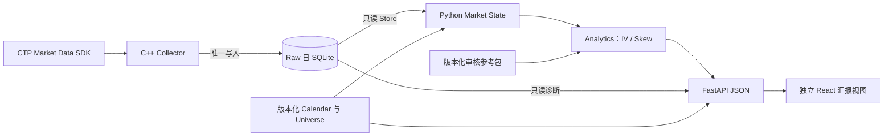
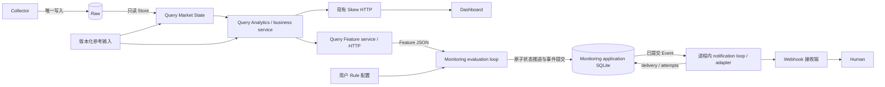

# 当前系统架构

本文回答“系统现在是什么结构”：组件职责、数据流、依赖方向、数据所有权和模块边界。选择这些边界的原因见[长期设计原则](design.md)，产品边界见 [MVP](mvp.md)，精确行为与失败语义只由对应 [Contracts](contracts/) 定义。本文不记录实现完成度；当前代码与验证缺口见[验收矩阵](acceptance.md)。



## 组件职责

| 组件 | 当前职责 | 边界 |
|---|---|---|
| CTP Market Data SDK | 提供外部行情回调与连接生命周期 | 是 Collector 的上游外部依赖，不是下游应用接口 |
| `collector/` | 接收行情、维护最新内存状态并物化 Raw；管理采集侧连接、订阅和运行诊断 | Raw 的唯一 writer；不计算业务指标，不依赖 Query 或 Dashboard |
| Raw 日 SQLite | 保存 Collector 实际物化的行情事实、运行身份与时间来源 | 由 Collector 拥有；所有下游只读，不为页面或算法建立第二套事实 |
| `collector/scripts/universe.py` | 生成和发布版本化合约清单参考 | 不写行情；清单是解释/订阅输入，不替代 CTP 行情事实 |
| `query/market_calendar.py` | 提供版本化交易日历、产品时段和逻辑交易日解释 | 不改写源 TradingDay，不控制采集启停 |
| `query/storage.py` / `app.py` | 只读访问 Raw，并提供诊断 JSON | 不写 Raw，不托管前端静态应用，不管理 Collector |
| `query/market_state.py` | 将 Raw、显式 Universe 和 Calendar 组合为可追溯的 point/minute/latest 市场状态 | 是 Analytics 的行情读取边界；不定价，不猜完整链 |
| `query/analytics.py` | 从 Market State frame 和显式参考输入计算 IV / Skew | 不直接访问 Raw SQL、网络或浏览器状态；结果属于可重建派生值 |
| `query/skew_service.py` / `skew_references.py` | 选择业务时间切片、固定读取上下文并投影 Skew JSON | 通过 Market State 和审核参考包工作，不暴露内部存储结构 |
| `dashboard/` | 构建独立 React 汇报页面；Docker 由 Nginx、原生 systemd 由 Vite 提供页面及 API 代理 | 只消费 JSON；不读 SQLite，不维护另一套指标公式 |
| `compose.yaml` / `scripts/deploy.sh` | 组成和管理仓库级三服务 Docker runtime | 属于系统 integration layer；服务内部构建和运行输入仍由各模块拥有 |
| `harness/` 与模块测试 | 组织回归并记录验证证据 | 不定义产品行为，也不进入生产数据路径 |

## 数据流与依赖方向

1. Collector 从 SDK 接收行情并把实际物化结果写入按源交易日组织的 Raw 日库。
2. Query 的只读 Store 从同一 Raw 目录取得事实；Market State 再结合显式 Universe 与 Calendar 形成稳定的下游读取模型。
3. Analytics 只消费 Market State frame 和独立审核参考包。业务 service 负责时间切片、读取身份固定及 JSON 投影。
4. FastAPI 提供 JSON；Dashboard 通过 API 展示业务结果和诊断，不跨过 API 访问数据文件。

正式依赖只沿图中箭头向下游移动。Dashboard、Analytics、Query 或参考数据故障不会形成反向调用来控制 Collector；部署工具协调生命周期，但不进入行情 callback 或 Raw 写入路径。

## 数据所有权

| 数据/记录 | Owner | 允许的消费者 |
|---|---|---|
| Raw 行情日库与采集运行诊断 | Collector | Query 只读访问；运维工具按契约检查或备份 |
| Universe generations 与源响应 | Universe 管理工具 | Collector 订阅入口、Market State、coverage 与审核流程 |
| Calendar 版本 | Query 参考数据模块 | Market State、业务 service、coverage 与运维检查 |
| Analytics ReferenceBundle | 独立审核/导入流程 | Analytics 及其只读适配层 |
| IV / Skew 响应 | Analytics / business service | API 与 Dashboard；当前不是第二份持久化事实库 |
| 验收日志和现场证据 | Harness / 验收流程 | Acceptance 引用；不进入 runtime |

数据集的精确 schema、锁、版本、时间、质量、选择和错误规则不在本表重复，分别见 [Collector](contracts/collector.md)、[Read Path](contracts/read-path.md)、[Market State](contracts/market-state.md)、[Calendar / Universe](contracts/market-session.md)、[Deployment](contracts/deployment.md)及 [Analytics / Skew v1](contracts/analytics-skew.md)。

## Runtime 与模块边界

正式 runtime 由独立的 C++ Collector、Python Query/FastAPI 和 React Dashboard 组成。原生 systemd 通过 Vite 服务页面，Docker Compose 通过 Nginx 服务构建产物。两套部署入口共享上述组件边界，但具体进程、挂载、端口、构建输入和生命周期规则由 [Deployment Contract](contracts/deployment.md)定义，实际命令见 [Operations](operations.md)及模块 README。

本地 developer runner 的职责属于开发工具层，只组合现有组件进程，不进入业务数据流，也不成为持久部署管理器。其会话所有权由 [Deployment Contract](contracts/deployment.md#developer-runner-的生命周期边界)规定；实现状态见 [Acceptance](acceptance.md)。这一边界不新增业务组件或改变上文数据所有权。

`experiments/` 是探索空间，不是正式 runtime、Architecture 或 Contract 的替代来源。实验成果只有在明确纳入相应正式模块并同步 Architecture/Contract 后，才成为系统结构的一部分。

## Monitoring v1 目标结构（已冻结，待实现）

本节是 [MVP 平行扩展](mvp.md)的目标边界，不将现有三组件部署改称已部署四组件。当前实现/验证程度见 [Acceptance](acceptance.md)；结构变化以 additive development 落地。



图中箭头表示数据流；运行调用为 Monitoring → Query HTTP，以及 Notification → 用户接收端。不存在 Collector → Analytics/Monitoring、Query → Monitoring、Rule Evaluation → Notification 复判或 Dashboard 本地规则判断的代码依赖。

### 必须落地的边界与保留的实现

- Market State、Feature、Conclusion、Opportunity Event 的语义分别由 [Feature](contracts/features.md)和 [Monitoring](contracts/monitoring.md) Contracts 定义；目录归属不混淆语义归属。
- Market State、Analytics 数值核心、参考包适配和 SkewService 暂留 `query/`。新增薄 Feature service 和 HTTP 投影复用它们；现有 API 与 Dashboard 保持兼容，不迁移首页。
- 拟新增 `monitoring/` 是独立前台进程，内含纯规则核心、application store、HTTP consumer/scheduler 和 Notification adapter。评估和投递独立循环，同进程不同职责，不要求拆成独立项目或服务。
- Monitoring 只经 Feature HTTP 消费指标，不读 Raw、不导入 Query 内部模块、不挂载行情目录。Query 不依赖 Monitoring 启动，也不为显示指标读取规则状态。
- Analytics/provider 不依赖 Monitoring；Notification 只消费已提交事件，不参与规则判断。任何下游错误都不能成为 Collector 停启、写入或健康的前置条件。
- 首版不提取顶层 `analytics/`，不新增消息队列、Derived Market DB 或 distributed runtime。共享包提取以独立 Python 消费者、独立发布需求或 HTTP 性能证据为触发条件，理由见 [Design](design.md)；提取不得改变 Feature 业务语义。

### 扩展数据所有权

| 数据/状态 | Owner | 持久化与消费者 |
|---|---|---|
| Raw / Market State / ReferenceBundle | 沿用上文 Collector 与 Query 所有权 | Monitoring 无直接行情访问权；参考输入仍由独立审核流程维护 |
| Feature 结果 | Query Analytics / provider | 按请求计算、可重建；Query API、Dashboard API 消费者和 Monitoring 可消费 |
| rolling market window | Feature provider | 后续指标按需从 Market State 重建；可丢弃缓存，不归 Rule Engine，不成为新 Market Facts |
| Rule configuration | 用户定义；Monitoring 应用已校验版本 | 本地 JSON，已应用版本保存至 application store；无管理 UI/热更新 |
| Evaluation State | Monitoring | 专属 SQLite，跨重启恢复；保存最近有效证据及缺口 |
| Opportunity Event | Monitoring | 同一 SQLite 中不可变应用事实；证据快照不取代原行情与参考 authority |
| Delivery / Attempts | Notification 逻辑拥有 | 物理复用同一 SQLite，与 Event 独立；目标秘密只通过环境引用 |

application store 是专属应用持久目录，不位于 Collector 数据目录。原子提交、去重、缺口、配置版本和投递恢复的唯一行为来源为 [Monitoring Contract](contracts/monitoring.md)，不得用物理共库推导通知可以修改事件或规则状态。

目标 runtime 仅增加一个可选本地进程，不接入当前 Compose/systemd 或平行 developer runner；生命周期约束见 [Deployment Contract](contracts/deployment.md)。故障隔离是调用、进程和写所有权边界，不承诺同宿主 CPU/磁盘资源完全隔离；轮询负载与延迟需实际验证，不能以进程独立替代性能证据。

<a id="knowledge-topology"></a>

## Repository knowledge architecture：冻结目标

本节拥有 documentation topology 和语义归属 mapping；治理规则唯一见[文档入口](README.md#authority-rules)。这是冻结的目标，不描述已完成迁移。当前仍由上文和现有中央 Contracts 提供结构/业务 authority；实施状态见 [Acceptance](acceptance.md#semantic-freeze)，执行顺序见 [ExecPlan](semantic-embedding-execplan.md)。

现状为根 AGENTS/README → docs 入口 → 中央 Design/Architecture/Contracts/Acceptance/Operations，生产模块主要只有 README；Harness 有局部验证入口；实验区已有逐层 SPEC/REFERENCE 组织。中央文档混合跨模块与模块内部语义，必须按规则组分配归属，不能整份按文件名搬迁。

目标文件如下；未列出的对称文件不创建。根 DESIGN/ARCHITECTURE 将承接当前 docs 下对应文件的 repository-level 内容；本节随 Architecture 一起迁移，不保留中央副本。

```text
/
├─ AGENTS.md / README.md / DESIGN.md / ARCHITECTURE.md / .authority.json
├─ docs/
│  ├─ README.md / mvp.md / acceptance.md / operations.md
│  ├─ contracts/
│  │  ├─ raw-boundary.md / read-path.md / market-session.md
│  │  └─ features.md / deployment.md
│  ├─ references/
│  └─ archive/
├─ collector/
│  ├─ AGENTS.md / README.md / ARCHITECTURE.md / CONTRACT.md / .authority.json
│  └─ scripts/
│     └─ AGENTS.md / README.md / CONTRACT.md / .authority.json
├─ query/
│  ├─ AGENTS.md / README.md / DESIGN.md / ARCHITECTURE.md
│  ├─ CONTRACT.md / ACCEPTANCE.md / .authority.json
│  ├─ contracts/
│  │  ├─ market-state.md / analytics-skew.md / analytics-skew-v1.json
│  │  └─ references.md
│  ├─ references/analytics-skew-sources.md
│  └─ calendars/README.md / .authority.json
├─ dashboard/
│  └─ AGENTS.md / README.md / CONTRACT.md / ACCEPTANCE.md / .authority.json
├─ monitoring/
│  ├─ AGENTS.md / README.md / DESIGN.md / ARCHITECTURE.md
│  └─ CONTRACT.md / ACCEPTANCE.md / .authority.json
├─ harness/
│  ├─ AGENTS.md / README.md / CONTRACT.md / .authority.json
│  └─ 原有实现、测试、oracle、fixtures
└─ experiments/（原位保留）
```

`query/contracts/` 是扁平 Query 的文档分卷，不是代码子模块；Calendar 解释算法仍归 Query，`query/calendars/` 只拥有参考文件维护入口。`collector/scripts/` 是现有真实工具 scope。根 `scripts/` 当前承担 repository integration，由系统 Operations/Deployment 导航，不另加空文档。

已冻结的 Monitoring 设计足以支持后续建立非空文档 scope，README 初期只导航设计和状态；没有实现时不提供虚构运行命令。不预建 rules/notification/storage 子目录，不创建顶层 analytics 包。

依赖归属必须区分工具与采集 runtime：`collector/scripts/universe.py` 实际导入 `query/market_calendar.py`，这不等于 C++ 采集依赖 Query 服务。native 管理器虽位于 Collector 目录却管理三个服务，其系统生命周期语义属于根。本迁移不移动这些代码，也不扩大已有合法依赖。

实验入口为 [CTP](../experiments/ctp/README.md) 和 [Data Coverage](../experiments/data_coverage/README.md)。后者已有 AGENTS/DESIGN/SPEC → 数据类型 SPEC → 来源 REFERENCE/coverage/templates，是 progressive disclosure 案例；本次不更改其内容、命名、样本或局部规则。

<a id="authority-mapping"></a>

## Current → target authority mapping

本表是归属与导航 authority，不复制业务规则。左列是迁移前可读取的真实来源，右列是冻结目标。尚未执行时以左列定义为准；每项迁移原子切换链接与定义，再将本表更新为现行归属导航，移除已无用途的旧来源说明。执行状态不在本表维护。

| 当前来源 / 语义范围 | 唯一目标及拆分边界 |
|---|---|
| [根 AGENTS](../AGENTS.md)、[docs 入口](README.md) | 根 AGENTS 工作纪律及导航；docs README 治理规则。根不列全仓领域必读清单 |
| [Design](design.md) §1–8 | 跨模块原则到根 DESIGN；Analytics 按请求计算等局部理由到 Query DESIGN |
| Design §9 | HTTP 共享、拆包触发和反向依赖理由留根；薄 provider 组织理由到 Query DESIGN |
| Design §10 | 机会记录/通知恢复内部取舍到 Monitoring DESIGN；与 Market Facts 的跨模块边界留根并引用 |
| 本文当前架构 | 根 ARCHITECTURE 保留一级模块、跨模块流、当前/目标 runtime；Query 内部文件关系与 Monitoring 循环/存储结构下放各自 ARCHITECTURE |
| [Collector Contract](contracts/collector.md) | callback、采样、session、配置、重连、提交、停止到 collector/CONTRACT.md；Raw 共享读写、锁、诊断协议到 docs/contracts/raw-boundary.md |
| [Read Path](contracts/read-path.md)：边界/健康/SQLite | 系统挂载与生命周期归 Deployment；共享 Raw/心跳协议归 raw-boundary；公共 HTTP 保留 read-path；Query 内部读取要求归 query/CONTRACT.md |
| Read Path：Skew | HTTP 参数、wire shape、状态映射保留根 read-path；分钟选择、series 计算引用 Query Skew，删除重复定义 |
| Read Path：React | 布局、轮询、失败清值、显示精度、历史与当前视图交互归 dashboard/CONTRACT.md |
| [Market Session](contracts/market-session.md) | Calendar/Universe 跨模块版本、时间、交接协议留根；来源抓取/发布行为到 collector/scripts/CONTRACT.md；Query 内部 Calendar/coverage 适配到 query/CONTRACT.md；页面时段表到 Dashboard |
| [Market State](contracts/market-state.md) | query/contracts/market-state.md；引用根 Raw/Calendar 协议，去掉重复采集事实 |
| [Skew](contracts/analytics-skew.md) | query/contracts/analytics-skew.md；纯页面规则到 Dashboard；审核包布局/导入/读取适配到 query/contracts/references.md；§10 历史记录与 §11 实现/测试证据到 query/ACCEPTANCE.md，保留 §11 的真实接口规范，不能整节删除 |
| [Skew 策略](contracts/analytics-skew-v1.json)、[来源说明](references/analytics-skew-sources.md) | query/contracts/analytics-skew-v1.json、query/references/analytics-skew-sources.md；共享原件档案不动 |
| [Feature](contracts/features.md) | 通用 envelope、身份/采样键、时间、错误、版本、消费者与窗口归属边界留根；registry/provider 内部要求到 Query CONTRACT；Skew 映射留根单一定义并引用 Query 数值契约 |
| [Monitoring](contracts/monitoring.md) | monitoring/CONTRACT.md 拥有规则、crossing、UNKNOWN、配置、事务、恢复、投递；跨模块访问和生命周期引用根，删除重复约束 |
| [Deployment](contracts/deployment.md) | 保留真实跨组件约束；Collector 自身停机引用 Collector；Monitoring 自有锁/重试引用 Monitoring |
| [Collector README](../collector/README.md) | 配置用法保留，已有规范归局部 Contract；三服务部署教程到根 Operations；工具命令到 scripts README |
| [Query README](../query/README.md)、[Dashboard README](../dashboard/README.md) | 保留实际用法、故障定位并增加本级导航；Query 增加已实现 Feature 用法 |
| [Calendar README](../query/calendars/README.md) | 保留参考数据维护步骤，不承接 Query 解释算法 |
| [Acceptance](acceptance.md) | G1–G6/P1/P2、跨进程/部署/runner 证据留根；Query/Dashboard/Monitoring 局部记录原样迁入各自 ACCEPTANCE，根只链接，不复制进度 |
| [Operations](operations.md) | 系统组合、部署、备份恢复保留根；模块操作归所属 README，根导航而不重复步骤 |
| [Harness README](../harness/README.md) | 用法/依赖保留；PASS/FAIL/NOT_RUN、证据身份和结果边界归 harness/CONTRACT.md，工作指导归 harness/AGENTS.md |
| [Monitoring execution plan](monitoring-execution-plan.md) | 仍为独立一次性交接；只更新链接与恢复说明，不成为规则定义，不因文档迁移执行业务里程碑 |
| [References](references/README.md)、[Archive](archive/README.md) | 共享原件、历史正文留原位；调整活动链接；局部 Skew 来源按上项迁移 |
| Experiments | 沿用既有局部 authority；根只导航，内部重复问题另行处理 |

<a id="authority-registration"></a>

## 目标机器导航

受管理 scope 的 `.authority.json` 只保存关系，不保存业务正文：版本、scope ID/物理根/parent/入口、现有或冻结待实现状态、文档路径与角色；唯一 claim ID、定义路径及稳定显式锚点、受约束 scopes；引用/证据/参考关系；允许的跨 scope 代码依赖及根约束来源。

claim 按可独立修改的接口或规则组划分，不为每句话建 ID。Markdown 与机器策略各自登记职责：Skew 已有机器字段值以原 JSON 为机器 authority，Markdown 解释含义，重复数值展示只作为受一致性检查的投影。登记不能制造第二套规则或把 evidence/ExecPlan 注册为规范。

该登记及其检查尚待实现；具体检查、迁移例外与关闭条件只在 [ExecPlan](semantic-embedding-execplan.md)安排。此处不要求当前工作树已有未来文件。
