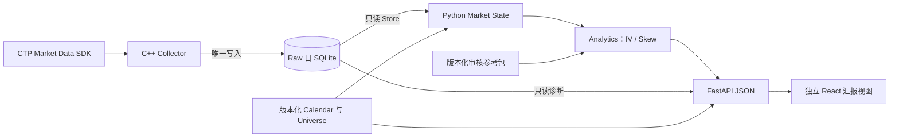

# 当前系统架构

本文回答“系统现在是什么结构”：组件职责、数据流、依赖方向、数据所有权和模块边界。选择这些边界的原因见[长期设计原则](design.md)，产品边界见 [MVP](mvp.md)，精确行为与失败语义只由对应 [Contracts](contracts/) 定义。本文不记录实现完成度；当前代码与验证缺口见[验收矩阵](acceptance.md)。

## 组件职责

| 组件 | 当前职责 | 边界 |
|---|---|---|
| CTP Market Data SDK | 提供外部行情回调与连接生命周期 | 是 Collector 的上游外部依赖，不是下游应用接口 |
| `collector/` | 接收行情、维护最新内存状态并物化 Raw；管理采集侧连接、订阅和运行诊断 | Raw 的唯一 writer；不计算业务指标，不依赖 Query 或 Dashboard |
| Raw 日 SQLite | 保存 Collector 实际物化的行情事实、运行身份与时间来源 | 由 Collector 拥有；所有下游只读，不为页面或算法建立第二套事实 |
| `collector/scripts/universe.py` | 生成和发布版本化合约清单参考 | 不写行情；清单是解释/订阅输入，不替代 CTP 行情事实 |
| `query/market_calendar.py` | 提供版本化交易日历、产品时段和逻辑交易日解释 | 不改写源 TradingDay，不控制采集启停 |
| `query/storage.py` / `app.py` | 只读访问 Raw，并提供诊断 JSON | 不写 Raw，不托管前端静态应用，不管理 Collector |
| `query/market_state.py` | 将 Raw、显式 Universe 和 Calendar 组合为可追溯的 point/minute/latest 市场状态 | 是 Analytics 的行情读取边界；不定价，不猜完整链 |
| `query/analytics.py` | 从 Market State frame 和显式参考输入计算 IV / Skew | 不直接访问 Raw SQL、网络或浏览器状态；结果属于可重建派生值 |
| `query/skew_service.py` / `skew_references.py` | 选择业务时间切片、固定读取上下文并投影 Skew JSON | 通过 Market State 和审核参考包工作，不暴露内部存储结构 |
| `dashboard/` | 构建独立 React 汇报页面；Docker 由 Nginx、原生 systemd 由 Vite 提供页面及 API 代理 | 只消费 JSON；不读 SQLite，不维护另一套指标公式 |
| `compose.yaml` / `scripts/deploy.sh` | 组成和管理仓库级三服务 Docker runtime | 属于系统 integration layer；服务内部构建和运行输入仍由各模块拥有 |
| `harness/` 与模块测试 | 组织回归并记录验证证据 | 不定义产品行为，也不进入生产数据路径 |

## 数据流与依赖方向

1. Collector 从 SDK 接收行情并把实际物化结果写入按源交易日组织的 Raw 日库。
2. Query 的只读 Store 从同一 Raw 目录取得事实；Market State 再结合显式 Universe 与 Calendar 形成稳定的下游读取模型。
3. Analytics 只消费 Market State frame 和独立审核参考包。业务 service 负责时间切片、读取身份固定及 JSON 投影。
4. FastAPI 提供 JSON；Dashboard 通过 API 展示业务结果和诊断，不跨过 API 访问数据文件。

正式依赖只沿图中箭头向下游移动。Dashboard、Analytics、Query 或参考数据故障不会形成反向调用来控制 Collector；部署工具协调生命周期，但不进入行情 callback 或 Raw 写入路径。

## 数据所有权

| 数据/记录 | Owner | 允许的消费者 |
|---|---|---|
| Raw 行情日库与采集运行诊断 | Collector | Query 只读访问；运维工具按契约检查或备份 |
| Universe generations 与源响应 | Universe 管理工具 | Collector 订阅入口、Market State、coverage 与审核流程 |
| Calendar 版本 | Query 参考数据模块 | Market State、业务 service、coverage 与运维检查 |
| Analytics ReferenceBundle | 独立审核/导入流程 | Analytics 及其只读适配层 |
| IV / Skew 响应 | Analytics / business service | API 与 Dashboard；当前不是第二份持久化事实库 |
| 验收日志和现场证据 | Harness / 验收流程 | Acceptance 引用；不进入 runtime |

数据集的精确 schema、锁、版本、时间、质量、选择和错误规则不在本表重复，分别见 [Collector](contracts/collector.md)、[Read Path](contracts/read-path.md)、[Market State](contracts/market-state.md)、[Calendar / Universe](contracts/market-session.md)、[Deployment](contracts/deployment.md)及 [Analytics / Skew v1](contracts/analytics-skew.md)。

## Runtime 与模块边界

正式 runtime 由独立的 C++ Collector、Python Query/FastAPI 和 React Dashboard 组成。原生 systemd 通过 Vite 服务页面，Docker Compose 通过 Nginx 服务构建产物。两套部署入口共享上述组件边界，但具体进程、挂载、端口、构建输入和生命周期规则由 [Deployment Contract](contracts/deployment.md)定义，实际命令见 [Operations](operations.md)及模块 README。

本地 developer runner 的职责属于开发工具层，只组合现有组件进程，不进入业务数据流，也不成为持久部署管理器。其会话所有权由 [Deployment Contract](contracts/deployment.md#developer-runner-的生命周期边界)规定；实现状态见 [Acceptance](acceptance.md)。这一边界不新增业务组件或改变上文数据所有权。

`experiments/` 是探索空间，不是正式 runtime、Architecture 或 Contract 的替代来源。实验成果只有在明确纳入相应正式模块并同步 Architecture/Contract 后，才成为系统结构的一部分。
