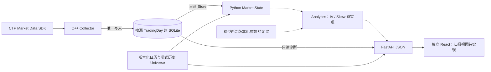

# MVP 系统架构

本项目保存市场事实，再在只读边界之外解释市场。Raw 日库是已采样行情事实的权威记录；它不代表未保留的 tick。仓库文档是设计、约束、来源与验收结论的权威入口。

实线为已有路径，虚线为待实现的业务路径。Market State 当前提供 Python/CLI 契约，尚无 Analytics HTTP API。Calendar 可脱离 Raw/HTTP 独立使用。

## 职责与所有权

| 组件/记录 | 负责 | 依赖和禁止事项 |
|---|---|---|
| `collector/` C++ | SDK 生命周期、精确代码订阅、内存 latest、15 秒 dirty 物化、日库、心跳/覆盖诊断 | 无 Python/Browser/HTTP 运行依赖；callback 不写 SQLite；不计算 IV/Skew，不发现合约 |
| `collector/data/YYYYMMDD.sqlite` | schema v1 的 dataset/runs/snapshots；长期市场事实 | C++ 唯一 writer；同日重启追加；不为页面新增表/索引，不建第二份权威 Raw |
| `collector/scripts/universe.py` | 公开合约清单、来源原响应、不可变 generation、原子 current | Python 标准库管理工具；不写行情；清单变化时由 native 正常重启 Collector |
| `query/market_calendar.py` | 参考日历、产品时段与逻辑交易日解释 | 不改源 TradingDay，不决定采集启停；缺参考返回 UNKNOWN |
| `query/storage.py` / `app.py` | 只读数据库访问、诊断 JSON 与有界查询 | WAL/目录锁协议；不提供静态 JS，不控制 Collector |
| `query/market_state.py` | 单合约/产品/月/链的 as-of、minute、latest、质量与 revision | 显式 Universe、日历和时钟；不猜完整链、不补行情、不做定价 |
| Analytics（待实现） | 由 Market State 及显式参考参数计算 IV/Skew | 放在 Python 下游；不直接访问 Raw SQL；不影响采集；MVP 暂不引入 Derived SQLite 或常驻调度器 |
| `dashboard/` | 独立 React 页面；生产 Nginx 静态服务和同源 API 代理 | 无 SQLite、凭据、flow、Docker socket 挂载；不在浏览器另写一套权威指标公式 |
| `harness/` 与模块测试 | 可重复回归、证据范围与收尾门槛映射 | 测试 SDK 仅用于隔离测试；无实盘启动或配置修改 |

`experiments/` 暂不整理。正式 Collector 构建继续引用其 `ctp/common` 与 `ctp/sdk`，这是现有构建依赖，不是新增运行服务。实验 coverage harness 与产品验收 harness 各自独立。

## 稳定边界

1. **采集独立**：Python 停止、浏览器关闭时仍接收并提交；部署管理器使用 Python 不等于 C++ ingestion 依赖 Python。
2. **事实与派生分离**：Raw 保存 46 个非 reserve 源字段及接收/物化/run 身份；无效浮点写 NULL。Analytics 不纠正或覆盖 Raw。
3. **时间可解释**：仅合法源 TradingDay 决定文件。ActionDay、源 UpdateTime、本地 received_us、snapshot_us 各自保留。夜盘自然日期不决定分区。
4. **采样诚实**：默认 15000ms、只物化 dirty、同窗口保留最后接收；不承诺逐 callback 无损、硬实时或断线回补；无新 callback 不写新行情。
5. **只读安全**：活跃库使用 WAL，离线 immutable 必须持目录共享锁且无非空 WAL。活跃 Collector 采集另一日而旧日缺 sidecar 时明确 503，不能绕过锁或删除 WAL。
6. **健康分层**：进程心跳、连接登录、订阅、实际接收、数据质量、市场时段分别展示；休市或冷门合约不推送不能直接推断进程故障。
7. **本地与持久化**：Linux x86-64/WSL；服务生命周期与数据分离；宿主回环默认 8101/8000。配置、日志、flow 与数据不进入镜像；不增加交易或外网暴露。

详细不变量分别由 [Collector](contracts/collector.md)、[Read Path](contracts/read-path.md)、[Market State](contracts/market-state.md)、[Calendar/Universe](contracts/market-session.md)、[Deployment](contracts/deployment.md)定义。

## 业务输出与回看设计

Analytics 输出应携带 scope、实际 trading_day、effective_as_of、evaluated_at、historical、quality、不可计算原因，以及输入 observation ID、raw_revision、Universe/Calendar 版本、模型参数与算法版本。指标为空时保留原因；不得产生替代价格。报价 usable 只是基础质量，IV 求解须做自己的可计算性验证。

分钟回看复用 Market State 的固定 revision 语义；sealed 只是分钟结束，不保证迟到写入不会改变默认重建。复现结果必须保留相同 append-only Raw、明确历史清单和参考版本。现有当前清单不得自动用于历史计算。MVP 先采用按请求计算；是否需要缓存必须由真实性能证据驱动，缓存始终是可丢弃派生值。

汇报首页的业务对象、Skew 水平/变化、数据时间/质量位于首屏；服务、覆盖、行数等诊断按需展开。切换月份或分钟后清楚显示对象；错误清除对应有效状态，历史结果不得披上当前时间。

Skew 数学口径和参数源仍是 [MVP 待决项](mvp.md)，本文不擅自固定模型。历史日缺 sidecar 的只读限制暂作为显式操作限制保留；若实际回看流程必须停采而无法满足可用性门槛，应在同一只读边界内另行设计解决，不能把 503 算验收成功。
