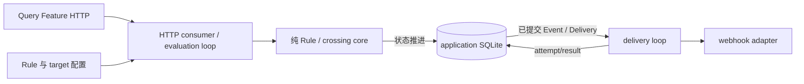

# Monitoring v1 内部目标结构

状态：**FROZEN / 待实现**。本文件描述已冻结的内部组件关系，不表示目录中已有 runtime 代码。跨模块数据流、所有权、Monitoring↔Query 访问和当前三服务部署边界由[根 Architecture](../ARCHITECTURE.md)与[Deployment Contract](../docs/contracts/deployment.md)拥有；内部精确行为见[本级 Contract](CONTRACT.md)。

首版是一个独立前台进程，内部职责保持分离：

- HTTP consumer / evaluation loop 每轮固定请求时刻，经共享 Feature HTTP 取得输入，再把显式 prior state、Rule 与 Evaluation 交给纯规则核心。
- 纯规则核心不访问网络、数据库、时钟或金融实现，只产生状态推进与可选 Opportunity Event 决定。
- application store 独占一份专属 SQLite，保存已应用 Rule 版本、Evaluation State、Event、Delivery 与 Attempts；状态/Event/初始 Delivery 在一个短事务中提交。
- delivery loop 只消费已提交 Event，与评估循环独立调度；webhook 网络等待期间不持有数据库事务，也不阻塞规则评估。

这些职责物理上同属本进程和同一扁平 scope，不预建 rules、notification、storage 子目录，不引入消息队列、独立通知服务、Derived Market DB 或分布式 runtime。未来代码文件和 SQL 表布局由实现决定，不能成为第二套业务规范。
